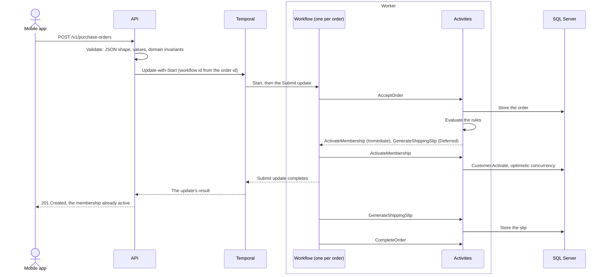

# FunBooksAndVideos

A purchase order processor for an online shop that sells books, videos and club memberships, after Dave Thomas's
Code Kata 16 (Business Rules). Each business rule is a small class that decides what an order needs, and a Temporal
workflow carries out those decisions durably.

- **BR1**: a membership in an order is active by the time the submission is confirmed (201, or 200 for a retry).
- **BR2**: physical products get a shipping slip.

The brief shows only some of the rules, so the design is judged by how cheaply and safely the next one can be added:
see [Adding a rule](#adding-a-rule).

## Where it runs

### Live, on my homelab

| What | Where | Open to |
| --- | --- | --- |
| API reference, to try it | <https://dev-funbooks.remusd.info> | Anyone, no sign-in |
| Temporal UI | <https://dev-funbooks-temporal.remusd.info> | My home network and tailnet, with single sign-on |
| Grafana | <https://grafana-hub.remusd.info>, the *FunBooksAndVideos* dashboard in the *funbooks* folder | The same |

A server in my homelab runs [deploy/compose.yml](deploy/compose.yml) with the images CI pushed for a pinned commit:
the API, two workers, SQL Server, the Temporal dev server and the Temporal UI. Visitors come through a Cloudflare
tunnel to the server's reverse proxy, which terminates HTTPS. SQL Server and Temporal stay on the app's internal
network. Telemetry goes through the homelab's OTLP gateway into Tempo, Prometheus and Loki, which the Grafana above
reads.

On the public address:

- Only `/`, `/scalar`, `/scalar/*`, `/openapi/*`, `/v1/*` and `/health/*` answer. Any other path gets 403.
- Cloudflare allows each address 20 requests in 10 seconds to `/v1/purchase-orders`, then answers 429 for 10
  seconds. Behind Cloudflare, the API accepts 3000 submissions a minute across all callers; the default is 30
  ([ADR 6](docs/adr/0006-validation-in-layers.md)).
- The brief's order, 3344656, is already stored, so submitting it gets 200, a replay. Give it a new id to see a 201.

### Locally

```shell
docker compose up --build --wait
```

This needs Docker. The same UIs are then at <http://localhost:5080> (API reference), <http://localhost:8233>
(Temporal) and <http://localhost:3000> (Grafana).

To run the two hosts from source (needs the .NET 10 SDK), start their dependencies, then each host in its own
terminal:

```shell
docker compose up --wait sqlserver temporal lgtm
dotnet run --project src/FunBooksAndVideos.Api
dotnet run --project src/FunBooksAndVideos.Worker
```

## What to look at

**The API reference** (Scalar) lists every endpoint and status code, with the brief's order as the example. Submit
it, then:

- `GET /v1/customers/4567890/memberships` shows Book Club, active before the 201 came back.
- `GET /v1/purchase-orders/3344656` shows the shipping slip, generated just after the 201.
- Submit the same order again and you get 200. Change its contents under the same id and you get 409.

**The Temporal UI** has one workflow per order, `purchase-order-{id}`. Its history shows the steps in order:

1. `AcceptOrder` stores the order and runs the rules. Its result is the list of commands.
2. `ActivateMembership` activates the club.
3. The `Submit` update completes. This is when the API answers 201.
4. `GenerateShippingSlip` stores the slip.
5. `CompleteOrder` marks the order complete.

A retried submission joins the same workflow instead of starting a new one.

**The Grafana dashboard** has five panels:

| Panel | Shows |
| --- | --- |
| *Submissions a minute, by status* | The submissions, by the status the API answered ([The API](#the-api)). |
| *Submission latency, p95* | How long a client waits, BR1's activation included. |
| *Activities a second, per worker* | One line per worker replica. |
| *Waiting for a worker, p95* | How long a workflow task waits in Temporal's queue. It rises when the workers fall behind, and can't read above 10 s, the histogram's top bucket. |
| *Recent submissions* | A trace per order, from the POST through the workflow on whichever worker ran it, down to each rule and SQL statement. On the homelab, a trace also links to its logs and its service map. |

### Under load

[A k6 script](load/submissions.js) submits 20 orders a second for two minutes. Add a worker while it runs:

```shell
docker compose run --rm k6
docker compose up -d --scale worker=3   # in a second terminal
```

*Activities a second, per worker* goes from two lines to three, each taking an equal share. `-e RATE=50` sets
another rate.

The Temporal dev server caps the throughput. Locally the cap is about 50 orders a second: more workers spread the
work but don't raise the cap. Past it, the API answers 202 and then 503, as documented. On the homelab, the server's
shared disk lowers the cap to about 20 a second. In one run at 20 a second, a disk stall left a backlog, and the API
answered 503 until the load stopped. No order was lost. For that reason, k6 runs on the homelab at `RATE=10`, from
the server itself, through its proxy.

## Test it

```shell
dotnet test
```

This needs Docker. The domain tests need no infrastructure. The integration tests start a real SQL Server
(Testcontainers) and a Temporal dev server, then drive the API and a worker, each composed as in its host.

The [Postman collection](postman/) runs the brief's example and the edge cases, and asserts every response. Import it
with the `local` environment, or run it headless:

```shell
docker run --rm --add-host host.docker.internal:host-gateway -v "$PWD/postman:/etc/newman" postman/newman:6.1.3-alpine \
  run FunBooksAndVideos.postman_collection.json -e local.postman_environment.json \
  --env-var baseUrl=http://host.docker.internal:5080
```

To run it against the live demo, set `baseUrl=https://dev-funbooks.remusd.info` instead.

## How it works



- **The rules are pure.** They turn an order into fulfilment commands. Some run before the caller hears back
  (`Immediate`, BR1); others may run after (`Deferred`, BR2).
- **Each command runs as an activity.** Activities are idempotent, retried with backoff and recorded in the
  workflow's history, so a crash, a deploy or a database blip only delays an order.
- **The rules run inside `AcceptOrder`.** Their decision is recorded once, so changing a rule can't break the replay
  of orders already in flight.
- **The order id is the idempotency key.** A retry gets the same order back. A different order under the same id gets
  409.
- **The API and the worker share only Temporal and the database.** The API starts workflows and reads SQL. The
  workers run the workflows and activities, and scale on their own
  ([ADR 8](docs/adr/0008-three-tiers-and-a-worker-host-of-its-own.md)).

## The API

| Request | Status | Meaning |
| --- | --- | --- |
| `POST /v1/purchase-orders` | 201 | Accepted. Its memberships are active. |
| | 200 | A retry of a stored order. Its memberships are active. A retry that overlaps the original can also get 201. |
| | 202 | Stored, but activation wasn't confirmed within 10 s. Poll the Location, or resubmit. |
| | 400 | Invalid. Nothing was processed. |
| | 409 | The id is taken, by a different order or by an earlier submission that can't run again. |
| | 429 | Too many submissions. |
| | 503 | Not confirmed within 10 s, and not stored. Resubmitting is safe. |
| `GET /v1/purchase-orders/{id}` | 200 | The order and its status, with its shipping slip once one exists. |
| | 404 | No such order. |
| `GET /v1/customers/{id}/memberships` | 200 | The customer's clubs. A customer this service has never seen has none. |
| Either `GET` | 400 | A blank or over-long id. |

The brief's order, as it is sent:

```json
{
  "id": "3344656",
  "customerId": "4567890",
  "total": 48.50,
  "items": [
    { "type": "video", "title": "Comprehensive First Aid Training" },
    { "type": "book", "title": "The Girl on the train" },
    { "type": "membership", "membership": "bookClub" }
  ]
}
```

Errors are RFC 9457 problem details, each with a trace id. A 400 lists its problems under `errors`:

- A body that breaks the contract gets the first place it breaks, by JSON path (`"$.items[1]"`).
- Otherwise, every invalid value is listed at once, by field (`"items[2].title"`).

The OpenAPI document is generated from the controllers' `[ProducesResponseType]` attributes and XML comments, so it
lists every status code above.

## Adding a rule

Take the kata's next rule: *a book needs a duplicate packing slip for the royalty department*.

1. Write `RoyaltySlipRule : IPurchaseOrderRule`. The rule is pure, so its tests need no infrastructure (see
   [BusinessRuleTests](tests/FunBooksAndVideos.Domain.Tests/BusinessRuleTests.cs)).
2. Register it in [PurchaseOrderWorker](src/FunBooksAndVideos.Worker/PurchaseOrderWorker.cs) with
   `services.AddRule<RoyaltySlipRule>();`. Registering it also makes it traced.
3. Add a `GenerateRoyaltySlip` command for the new effect, and a matching `IFulfilment` method. The build fails until
   both receivers implement the method: the real activities and the workflow's activity proxy.
4. Give the command a JSON name in [HierarchyJson](src/FunBooksAndVideos.Infrastructure/Json/HierarchyJson.cs), so
   the workflow can record it, and add a value of it to
   [DomainJsonTests](tests/FunBooksAndVideos.IntegrationTests/DomainJsonTests.cs). The compiler can't check this
   step, so that test fails until both are done.

The processor, the workflow and the API don't change. A rule that reuses an existing effect needs steps 1 and 2 only.

## Patterns

Each pattern solves a problem in this code.

| Pattern | Where | What it buys |
| --- | --- | --- |
| Strategy | [`IPurchaseOrderRule`](src/FunBooksAndVideos.Domain/Rules/IPurchaseOrderRule.cs) and the two rules | A new rule is a new class. The processor doesn't change. |
| Command, dispatched Visitor-style | [`FulfilmentCommand`](src/FunBooksAndVideos.Domain/Fulfilment/FulfilmentCommands.cs): rules create commands, the workflow invokes them by `Timing`, and each command calls its own [`IFulfilment`](src/FunBooksAndVideos.Domain/Fulfilment/IFulfilment.cs) method | Deciding is separate from doing. A new effect won't compile until every receiver handles it. |
| Proxy | [`ActivityFulfilment`](src/FunBooksAndVideos.Application/Processing/ActivityFulfilment.cs) | The receiver's interface, with each call made a durable, retried activity. |
| Decorator | [`TracedRule`](src/FunBooksAndVideos.Infrastructure/Observability/TracedRule.cs) | Every rule evaluation is a span, and the rules know nothing about tracing. |
| Process manager | [`PurchaseOrderWorkflow`](src/FunBooksAndVideos.Application/Processing/PurchaseOrderWorkflow.cs) | A durable, multi-step process with forward recovery. [ADR 4](docs/adr/0004-forward-recovery-no-compensation.md) says when it would need a saga's compensations. |
| Idempotent receiver | [`OrderSubmitter`](src/FunBooksAndVideos.Application/Submission/OrderSubmitter.cs): the stored order, the workflow and update ids, the primary keys | A retry never activates or ships twice. |
| Result | [`SubmissionOutcome`](src/FunBooksAndVideos.Application/Submission/SubmissionOutcome.cs), mapped by [`PurchaseOrdersController`](src/FunBooksAndVideos.Api/Controllers/PurchaseOrdersController.cs) | Expected outcomes are values, not exceptions, and each maps to one status code. |
| Strategy per class hierarchy, sharing a template method | [`DiscriminatedJson<T>`](src/FunBooksAndVideos.Infrastructure/Json/DiscriminatedJson.cs), with a converter per hierarchy in [`HierarchyJson`](src/FunBooksAndVideos.Infrastructure/Json/HierarchyJson.cs) | One switch per hierarchy names each subtype in JSON by its runtime type, and the domain has no serialization attributes. |
| Aggregate | [`PurchaseOrder`](src/FunBooksAndVideos.Domain/PurchaseOrder.cs), [`Customer`](src/FunBooksAndVideos.Domain/Customer.cs) | Invariants live in one place, so an invalid order can't be constructed. |
| Value object | [`PurchaseOrderId`, `CustomerId`](src/FunBooksAndVideos.Domain/Identifiers.cs), [`Money`](src/FunBooksAndVideos.Domain/Money.cs), [`MembershipType`](src/FunBooksAndVideos.Domain/MembershipType.cs) | Ids can't be swapped, money in the domain is never a bare decimal, and Premium is literally both clubs. |
| Polymorphism, with no checks for concrete products | [`ProductLine.IsPhysical`](src/FunBooksAndVideos.Domain/ItemLines.cs) | BR2 asks "is it physical?", never "is it a book?". |
| Optimistic concurrency | A `rowversion` on customers, plus Temporal's retry ([ADR 5](docs/adr/0005-optimistic-concurrency-for-memberships.md)) | Two simultaneous orders can't lose a club. |
| Published language | [`Contracts/`](src/FunBooksAndVideos.Api/Contracts/), mapped by hand | The domain can change without breaking app versions already in the field. |
| Pipeline (MVC action filter) | [`ValidationFilter<T>`](src/FunBooksAndVideos.Api/Validation/ValidationFilter.cs) | An invalid request never reaches the action. |
| Object mother | [`PurchaseOrders`](tests/FunBooksAndVideos.Domain.Tests/PurchaseOrders.cs) | Tests read like the brief. |

Left out on purpose:

- **Specification**: each rule's condition is one line.
- **Chain of responsibility for the rules**: the rules are independent, and all of them apply.
- **MediatR and AutoMapper**: dependencies that are now commercially licensed, for what DI and a page of mapping code
  already do.
- **Generic repository**: the `DbContext` already is one, with its unit of work.
- **Outbox**: Temporal is the only write path for fulfilment, so there is no dual write to guard.
- **Domain events**: nothing would consume them yet.

## Decisions

1. [Temporal orchestrates fulfilment](docs/adr/0001-temporal-orchestrates-fulfilment.md)
2. [Immediate activation with Update-with-Start](docs/adr/0002-immediate-activation-with-update-with-start.md)
3. [The order id is the idempotency key](docs/adr/0003-order-id-is-the-idempotency-key.md)
4. [Forward recovery, no compensation](docs/adr/0004-forward-recovery-no-compensation.md)
5. [Optimistic concurrency for memberships](docs/adr/0005-optimistic-concurrency-for-memberships.md)
6. [Validation in layers](docs/adr/0006-validation-in-layers.md)
7. [Azure Container Apps, Azure SQL and Temporal Cloud](docs/adr/0007-azure-container-apps-sql-and-temporal-cloud.md)
8. [Three tiers, and a worker host of its own](docs/adr/0008-three-tiers-and-a-worker-host-of-its-own.md)

[How they were reached](docs/README.md): a BRD, an RFC and a plan, each ending at a gate where the owner answered,
then the build and its reviews.

## Assumptions

- Orders arrive paid. This service fulfils them. It neither prices nor charges, so it stores the total as given
  (GBP).
- The shop issues the order ids, and retries with the same id. That makes the id a safe idempotency key.
- Customer accounts live in the shop. This service records the memberships it activates. A customer it has never
  seen belongs to no club.
- Activation is a union. Buying Book Club as a Premium member changes nothing, and Book Club plus Video Club is
  Premium.
- Books are physical, and videos are watched online. A shipping slip is a record of what to ship. Printing it is out
  of scope.
- Authentication is out of scope (see below).

## Limits and next steps

Each shortcut is deliberate, and each has a way past it.

- **No authentication.** In production, a gateway authenticates the app, and orders and memberships are scoped to
  the signed-in customer. Reading an order by id would check that the caller owns it.
- **One API replica.** More replicas could share the load, and EF Core locks the startup migration. But the rate
  limit is held in memory, so each replica would apply it separately. Move it to a gateway first. Workers have no
  such limit: they scale with `worker_replicas` in Azure, or `--scale worker=N` on a host.
- **The apps sign in to SQL as an admin**, so that the API can migrate at startup: as their managed identity in
  Azure, and as `sa` on the homelab. An EF migration bundle in the pipeline would leave both apps with data rights
  only.
- **Azure SQL's public endpoint.** Azure services can reach the server, though signing in still needs Entra. VNet
  integration with a private endpoint closes it.
- **Temporal's dev server on the homelab.** It keeps its state in SQLite on a volume, and caps the throughput (see
  [Under load](#under-load)). A Temporal server with its own database would raise the cap, as would Temporal Cloud,
  which the Azure setup uses.
- **Every trace is kept.** Add sampling once ingestion starts to cost.
- **Unlimited activity retries** ([ADR 4](docs/adr/0004-forward-recovery-no-compensation.md)). Alert on the retry
  counts.
- **Workflow changes** need Temporal's versioning once orders are in flight
  ([ADR 1](docs/adr/0001-temporal-orchestrates-fulfilment.md)).
- **Local Terraform state.** It holds the Temporal API key. Move it to a storage-account backend with locking before a
  second person runs `apply`.

## Deploy it to Azure

Container Apps runs the API and the worker as two apps, Azure SQL holds the data, and Temporal Cloud runs the
workflows. [Terraform](infra/) creates all three. The [Deploy workflow](.github/workflows/deploy.yml) ships every
commit that passes CI on `main`, then runs the Postman collection against it. None of this has been applied:
`terraform validate` and actionlint pass, and the live demo runs on the homelab instead.

1. Push the repository to GitHub. Turn on CodeQL's default setup and secret scanning with push protection
   (*Settings*, *Advanced Security*). CI runs, and Deploy pushes two images, `ghcr.io/<owner>/<repo>-api` and
   `-worker`. Its Azure steps are skipped until step 4.
2. Make both packages public (package settings, *Change visibility*), so that Container Apps can pull them without
   credentials.
3. Create the infrastructure. You need the Azure CLI, signed in as an Owner or User Access Administrator of the
   subscription, who may also register Entra applications: Terraform gives the deploy workflow a role and an app
   registration. You also need a Temporal Cloud account API key. In `terraform.tfvars`, `image_prefix` is all
   lowercase, and `github_repository` is the repository as GitHub's OIDC tokens name it:
   `gh api repos/<owner>/<repo> --jq '"\(.owner.login)@\(.owner.id)/\(.name)@\(.id)"'`.

   ```shell
   az login
   export TEMPORAL_CLOUD_API_KEY=<account API key>
   cd infra
   cp terraform.tfvars.example terraform.tfvars   # then fill it in
   terraform init
   terraform apply
   ```

4. Copy `terraform output github_variables` into the repository's Actions variables. These are identifiers, not
   secrets: Deploy signs in to Azure with OpenID Connect.
5. Re-run Deploy, or push again. `terraform output api_url` gives the API's address.

## Layout

Each project depends only on the ones below it: the Api and the Worker on Application, Application on
Infrastructure, and Infrastructure on Domain.

```text
src/FunBooksAndVideos.Api                 the HTTP API: controllers, the contract and its validation
src/FunBooksAndVideos.Worker              the worker host: runs the workflows and activities, and scales on its own
src/FunBooksAndVideos.Application         submitting an order, the workflow and activities that fulfil it, the reads
src/FunBooksAndVideos.Infrastructure      SQL Server through EF Core, the domain's JSON, the Temporal client, telemetry
src/FunBooksAndVideos.Domain              the model, the rules and the commands: no packages, no I/O
tests/FunBooksAndVideos.Domain.Tests      rules and invariants, without infrastructure
tests/FunBooksAndVideos.IntegrationTests  workflow, replay, persistence, JSON, HTTP and tracing, against real SQL Server and Temporal
infra/                                    Terraform: Azure, Entra ID and Temporal Cloud
deploy/                                   compose for a host of its own, behind its proxy (the homelab's); its header lists what the host sets
observability/                            the Grafana dashboard
load/                                     the k6 load script
postman/                                  the collection and its local environment
docs/                                     how it was built: the BRD, the RFC, the plan and their gates
docs/adr/                                 the decisions above
```
