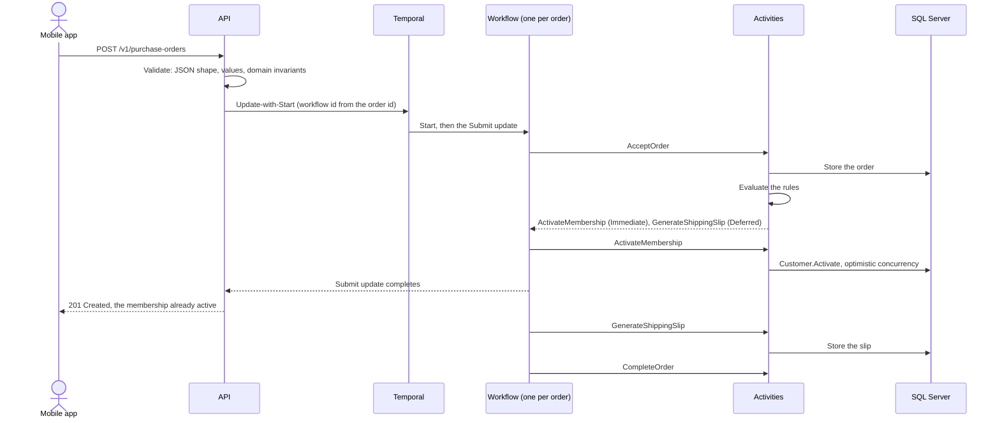

# FunBooksAndVideos

A purchase order processor for an online shop that sells books, videos and club memberships, built on Dave Thomas's
Code Kata 16 (Business Rules). Each business rule is a small class that decides what an order needs, and a Temporal
workflow carries the decisions out durably.

- **BR1**: a membership in an order is active by the time the submission is confirmed (201, or 200 for a retry).
- **BR2**: physical products get a shipping slip.

The brief shows some of the rules, not all of them, so the design is judged by how cheaply and safely the next rule
can be added. [Adding a rule](#adding-a-rule) shows how that works here.

## Run it

Needs Docker.

```shell
docker compose up --build
```

- API docs, to try it: <http://localhost:5080>
- Temporal UI, to watch the workflows: <http://localhost:8233>
- Traces, from the request through the workflow to each rule: <http://localhost:18888>

To run the API from source instead (needs the .NET 10 SDK), start only what it depends on:

```shell
docker compose up sqlserver temporal dashboard
dotnet run --project src/FunBooksAndVideos.Api
```

## Test it

```shell
dotnet test
```

Docker must be running. The domain tests are pure. The API tests start a real SQL Server (Testcontainers) and a real
Temporal dev server, then drive the application as `Program.cs` composes it.

The [Postman collection](postman/) walks through the brief's example and the edge cases, asserting every response.
Import it with the `local` environment, or run it headless against the running stack:

```shell
docker run --rm --add-host host.docker.internal:host-gateway -v "$PWD/postman:/etc/newman" postman/newman:6.1.3-alpine \
  run FunBooksAndVideos.postman_collection.json -e local.postman_environment.json \
  --env-var baseUrl=http://host.docker.internal:5080
```

## How it works



- The rules are pure. They turn an order into **fulfilment commands**, and each rule says whether its command must run
  before the caller hears back (`Immediate`, BR1) or may run after (`Deferred`, BR2).
- The workflow runs the commands through activities. Each activity is retried with backoff, is idempotent, and is
  recorded in the workflow's history, so a crash, a deploy or a database blip only delays an order.
- The rules run inside the `AcceptOrder` activity, so their decision is recorded once. A changed rule can't break
  the replay of orders already in flight.
- The order id is the idempotency key. A retried submission gets the same order back, and a different order reusing
  the id gets a 409.

## The API

| Endpoint | Answers |
| --- | --- |
| `POST /v1/purchase-orders` | **201** accepted, memberships already active. **200** the same order was submitted before (a retry), memberships active. **202** accepted, but activation is taking longer than 10 s: poll the Location, or resubmit. **400** invalid, nothing processed. **409** the id belongs to a different order. **429** too many submissions. **503** not confirmed within 10 s and not stored yet: resubmit, which is safe. |
| `GET /v1/purchase-orders/{id}` | **200** the order, its status and, once generated, its shipping slip. **404** no such order. |
| `GET /v1/customers/{id}/memberships` | **200** the customer's clubs (none for a customer this service has never seen). |

The brief's order, as it is sent:

```json
{
  "id": "3344656",
  "customerId": "4567890",
  "total": 48.50,
  "items": [
    { "type": "video", "title": "Comprehensive First Aid Training" },
    { "type": "book", "title": "The Girl on the train" },
    { "type": "membership", "membership": "bookClub" }
  ]
}
```

Errors are RFC 9457 problem details with a trace id. A contract violation names the JSON path
(`"path": "$.items[1]"`), and validation errors are keyed by field (`"items[2].title"`). The OpenAPI document is
generated from the handlers' result types, with descriptions from their XML comments, so every status code above is
in it.

## Adding a rule

Take the kata's next rule: *a book needs a duplicate packing slip for the royalty department*.

1. Write `RoyaltySlipRule : IPurchaseOrderRule`. It is pure, so its tests need no infrastructure
   (see [BusinessRuleTests](tests/FunBooksAndVideos.Domain.Tests/BusinessRuleTests.cs)).
2. Register it in [ProcessingServiceCollectionExtensions](src/FunBooksAndVideos.Api/Processing/ProcessingServiceCollectionExtensions.cs):
   `services.AddRule<RoyaltySlipRule>();`. It is traced from then on.
3. It needs a new effect, so add a `GenerateRoyaltySlip` command and a matching `IFulfilment` method. The build then
   fails until each receiver implements it: the real activities and the workflow's activity proxy.
4. Give the command a JSON name in [DomainJson](src/FunBooksAndVideos.Api/DomainJson.cs), so the workflow can record
   it. The compiler can't check this step, so [a test](tests/FunBooksAndVideos.Api.Tests/DomainJsonTests.cs) fails
   until it is done.

The processor, the workflow and the API don't change. A rule that reuses an existing effect is steps 1 and 2 only.

## Patterns

Each one is here because it solves a problem this code has.

| Pattern | Where | What it buys |
| --- | --- | --- |
| Strategy | [`IPurchaseOrderRule`](src/FunBooksAndVideos.Domain/Rules/IPurchaseOrderRule.cs) and the two rules | A new rule is a new class; the processor is closed for modification |
| Command, dispatched Visitor-style | [`FulfilmentCommand`](src/FunBooksAndVideos.Domain/Fulfilment/FulfilmentCommands.cs): rules create commands, the workflow invokes them honouring `Timing`, and each command calls its own [`IFulfilment`](src/FunBooksAndVideos.Domain/Fulfilment/IFulfilment.cs) method | Deciding is separate from doing; with the receiver as the visitor, a new effect won't compile until every receiver handles it |
| Proxy | [`ActivityFulfilment`](src/FunBooksAndVideos.Api/Processing/ActivityFulfilment.cs) | The receiver's interface, with each call made a durable, retried activity |
| Decorator | [`TracedRule`](src/FunBooksAndVideos.Api/Observability/TracedRule.cs) | Every rule evaluation is a span, and the rules know nothing about tracing |
| Process manager | [`PurchaseOrderWorkflow`](src/FunBooksAndVideos.Api/Processing/PurchaseOrderWorkflow.cs) | A durable, multi-step process with forward recovery; [ADR 4](docs/adr/0004-forward-recovery-no-compensation.md) says when it would need a saga's compensations |
| Idempotent receiver | [`OrderSubmitter`](src/FunBooksAndVideos.Api/Processing/OrderSubmitter.cs): the stored order, the workflow and update ids, primary keys | A retry never activates or ships twice |
| Result | [`SubmissionOutcome`](src/FunBooksAndVideos.Api/Processing/SubmissionOutcome.cs), mapped by [`Respond`](src/FunBooksAndVideos.Api/Endpoints/PurchaseOrderEndpoints.cs) | Expected outcomes are values, not exceptions, each with one status code |
| Aggregate | [`PurchaseOrder`](src/FunBooksAndVideos.Domain/PurchaseOrder.cs), [`Customer`](src/FunBooksAndVideos.Domain/Customer.cs) | Invariants live in one place: an invalid order can't be constructed |
| Value object | [`PurchaseOrderId`, `CustomerId`](src/FunBooksAndVideos.Domain/Identifiers.cs), [`Money`](src/FunBooksAndVideos.Domain/Money.cs), [`MembershipType`](src/FunBooksAndVideos.Domain/MembershipType.cs) | Ids can't be swapped, money is never a bare decimal, and Premium is literally both clubs |
| Polymorphism, no type checks | [`ProductLine.IsPhysical`](src/FunBooksAndVideos.Domain/ItemLines.cs) | BR2 asks "is it physical?", never "is it a book?" |
| Optimistic concurrency | `rowversion` on customers, plus Temporal's retry | Two simultaneous orders can't lose a club |
| Anti-corruption layer | [`Contracts/`](src/FunBooksAndVideos.Api/Contracts/), mapped by hand | The domain can change without breaking app versions already in the field |
| Pipeline (endpoint filter) | [`ValidationFilter<T>`](src/FunBooksAndVideos.Api/Validation/ValidationFilter.cs) | An invalid request never reaches the handler |
| Object mother | [`PurchaseOrders`](tests/FunBooksAndVideos.Domain.Tests/PurchaseOrders.cs) | Tests read like the brief |

Left out on purpose:

- **Specification**: each rule's condition is one line.
- **Chain of responsibility for the rules**: the rules are independent and all of them apply.
- **MediatR, AutoMapper**: dependencies, now commercially licensed, for what DI and a page of mapping code already do.
- **Generic repository**: the `DbContext` already is one, with its unit of work.
- **Outbox**: Temporal is the only write path for fulfilment, so there is no dual write to guard.
- **Domain events**: nothing would consume them yet.

## Decisions

Architecture decision records, in [docs/adr](docs/adr/):

1. [Temporal orchestrates fulfilment](docs/adr/0001-temporal-orchestrates-fulfilment.md)
2. [Immediate activation with Update-with-Start](docs/adr/0002-immediate-activation-with-update-with-start.md)
3. [The order id is the idempotency key](docs/adr/0003-order-id-is-the-idempotency-key.md)
4. [Forward recovery, no compensation](docs/adr/0004-forward-recovery-no-compensation.md)
5. [Optimistic concurrency for memberships](docs/adr/0005-optimistic-concurrency-for-memberships.md)
6. [Validation in layers](docs/adr/0006-validation-in-layers.md)
7. [Azure Container Apps, Azure SQL and Temporal Cloud](docs/adr/0007-azure-container-apps-sql-and-temporal-cloud.md)

## Assumptions

- Orders arrive paid. This service fulfils them; it neither prices nor charges, so the total is stored as given (GBP).
- The shop issues order ids and retries with the same id. That makes the id a safe idempotency key.
- Customer accounts live in the shop. This service records the memberships it activates, and a customer it has never
  seen belongs to no club.
- Activation is a union: buying Book Club as a Premium member changes nothing, and Book Club plus Video Club is Premium.
- Books are physical and videos are watched online. A shipping slip is a record of what to ship; printing it is out
  of scope.
- Authentication is out of scope (see below).

## Limits and next steps

The shortcuts are deliberate, and each has a known ceiling and a way past it.

- **No authentication.** In production, a gateway authenticates the app, and orders and memberships are scoped to the
  signed-in customer. Reading an order by id would check that the caller owns it.
- **One replica**, the cheapest setup. More replicas could share the task queue, and EF Core locks the startup
  migration, but the rate limit lives in memory: each replica would allow its own 30 a minute. Move it to a gateway
  first.
- **The API's identity is the SQL admin**, so that it can migrate at startup. An EF migration bundle in the pipeline
  would leave it with data rights only.
- **Public SQL endpoint.** Azure services can reach the server, though signing in still needs Entra. VNet integration
  with a private endpoint closes it.
- **Every trace is kept.** Add sampling when Application Insights ingestion starts to cost.
- **Unlimited activity retries.** A step that keeps failing stays visible in the Temporal UI instead of failing a paid
  order; alert on retry counts.
- **Workflow changes.** Once orders are in flight, changing the workflow's shape needs Temporal's versioning
  (patching). The replay test catches a non-deterministic change in CI.
- **Local Terraform state.** It holds the Temporal API key. Move it to a storage-account backend with locking before a
  second person runs `apply`.

## Deploy it

Azure Container Apps runs the API and its worker, Azure SQL holds the data, and Temporal Cloud runs the workflows.
[Terraform](infra/) creates all three, and the [Deploy workflow](.github/workflows/deploy.yml) ships every commit
that passes CI on `main`, then runs the Postman collection against it.

1. Push the repository to GitHub. CI runs, and Deploy pushes the image to `ghcr.io/<owner>/<repo>`; its Azure steps
   are skipped until step 4.
2. Make that package public (package settings, *Change visibility*), so Container Apps can pull it without
   credentials.
3. Create the infrastructure. It needs the Azure CLI signed in and a Temporal Cloud account API key:

   ```shell
   az login
   export TEMPORAL_CLOUD_API_KEY=<account API key>
   cd infra
   cp terraform.tfvars.example terraform.tfvars   # then fill it in
   terraform init
   terraform apply
   ```

4. Copy `terraform output github_variables` into the repository's Actions variables. They are identifiers, not
   secrets: Deploy signs in to Azure with OpenID Connect.
5. Re-run Deploy, or push again. `terraform output api_url` is the API.

## Layout

```text
src/FunBooksAndVideos.Domain          the model, the rules and the commands: no packages, no I/O
src/FunBooksAndVideos.Api             HTTP, the Temporal workflow and activities, EF Core, telemetry
tests/FunBooksAndVideos.Domain.Tests  rules and invariants, without infrastructure
tests/FunBooksAndVideos.Api.Tests     workflow, replay, persistence, HTTP and tracing, against real SQL Server and Temporal
infra/                                Terraform: Azure, Entra ID and Temporal Cloud
postman/                              the collection and its environments
docs/adr/                             the decisions above
```
